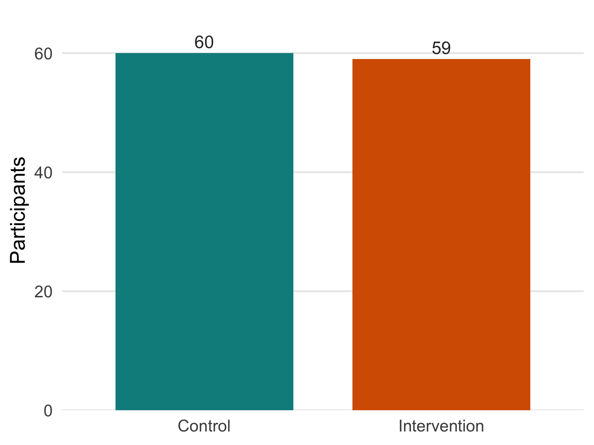
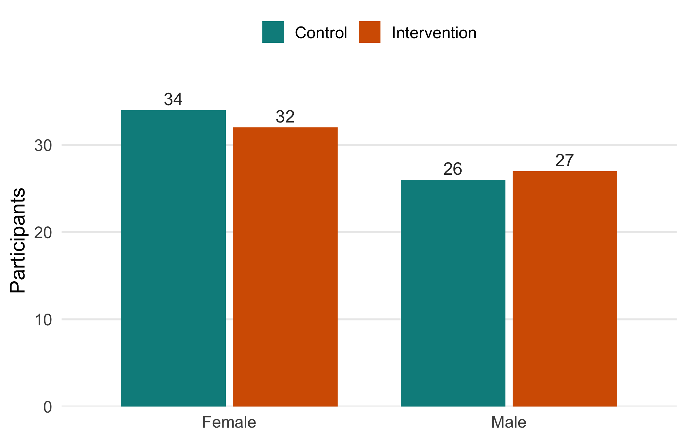
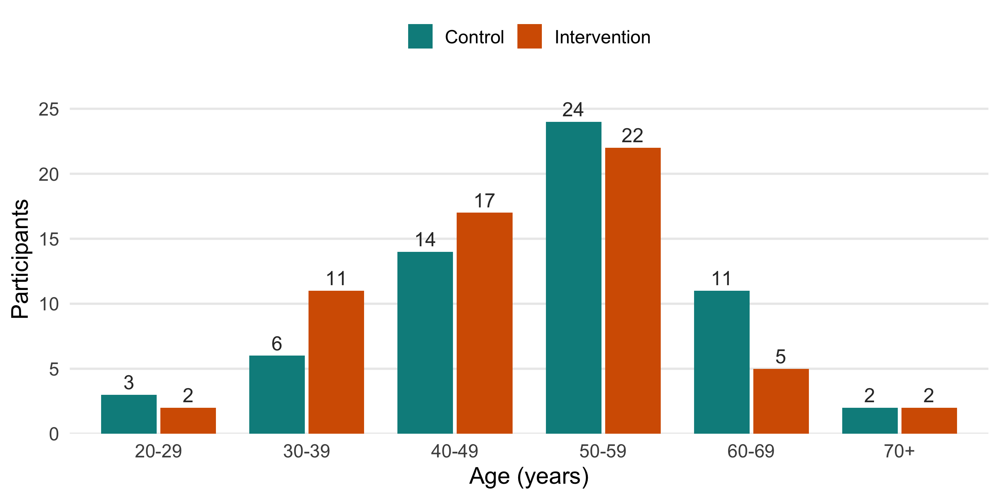
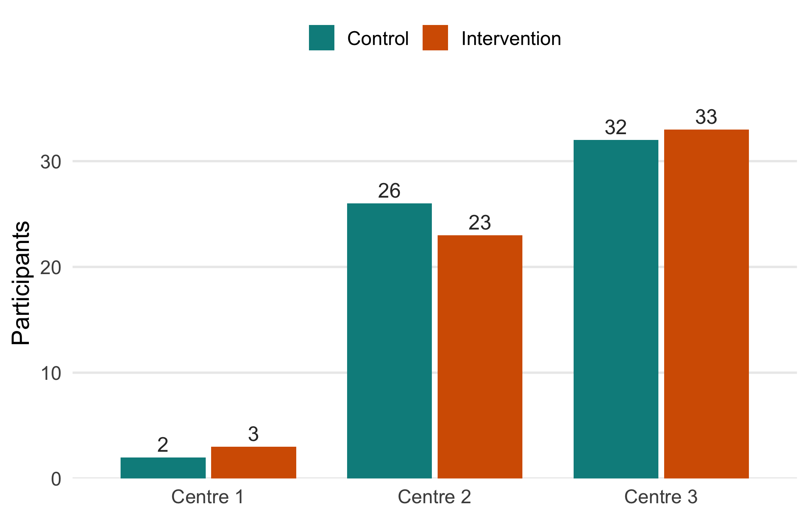
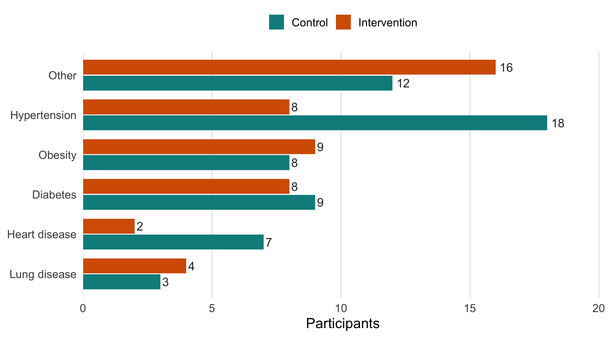
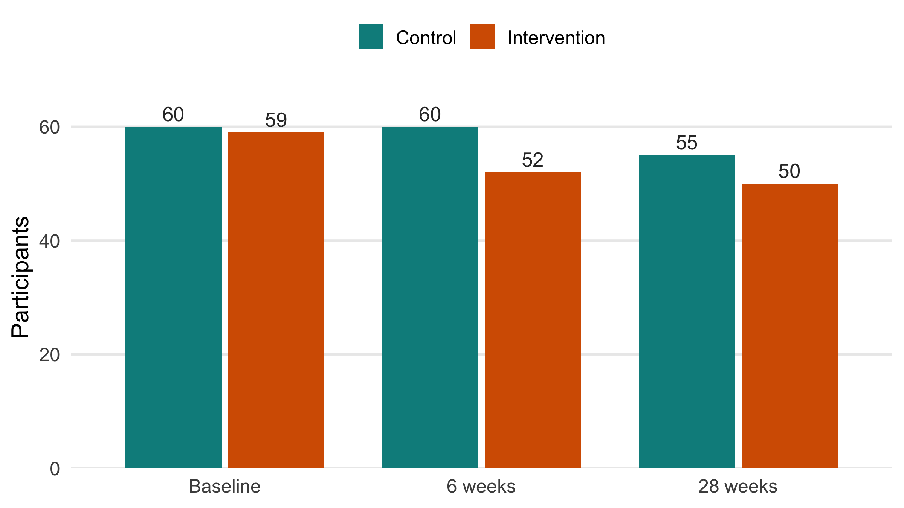
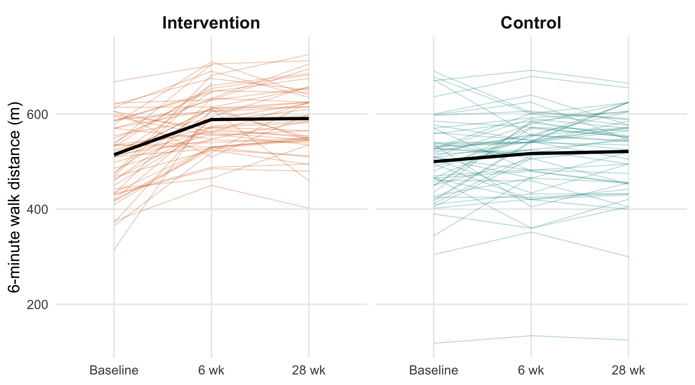
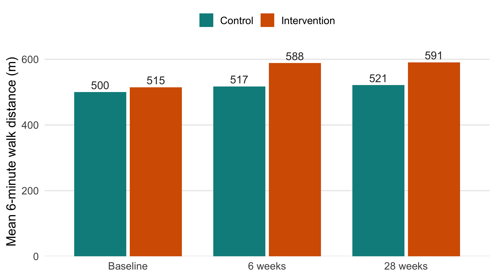
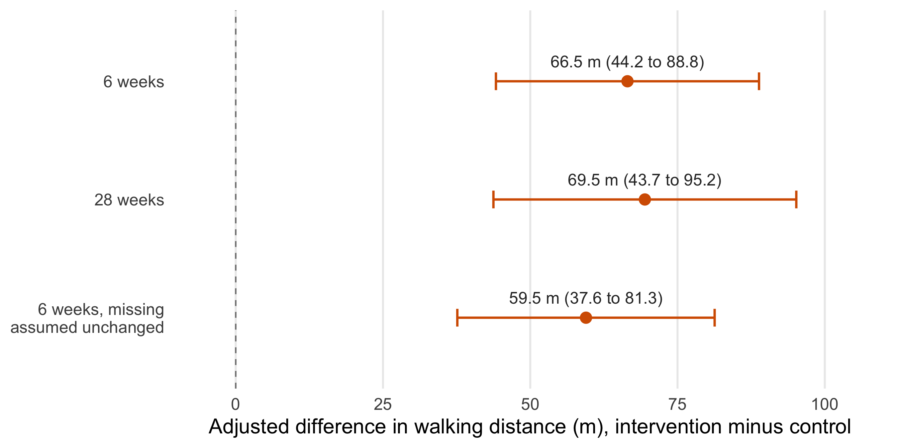

# Did Home-Based Telerehabilitation Improve Walking After COVID-19?

### A re-analysis of the TERECO randomised controlled trial in R


-2E8B57)


**Project Done by:** Nurjahan Sultana  
**Contact:** [nurjahan.sultana@stu.mmu.ac.uk](mailto:nurjahan.sultana@stu.mmu.ac.uk)  
**Date:** October 2023  
**Tools:** R (`dplyr`, `tidyr`, `ggplot2`)

---

## Contents

1. [Summary](#1-summary)
2. [Background: the TERECO trial](#2-background-the-tereco-trial)
3. [Research question](#3-research-question)
4. [The dataset](#4-the-dataset)
5. [Methods](#5-methods)
6. [Results](#6-results)
7. [Sensitivity check](#7-sensitivity-check)
8. [Limitations](#8-limitations)
9. [Conclusion](#9-conclusion)
10. [Repository structure](#10-repository-structure)
11. [How to run the analysis](#11-how-to-run-the-analysis)
12. [References](#12-references)

---

## 1. Summary

This project re-analyses public data from the **TERECO trial**. The trial tested
whether a six-week home exercise programme, delivered through a smartphone app,
helped people walk further after they left hospital following COVID-19.

I used the public trial data (119 adults) and compared walking distance between
the programme group and the control group, adjusting for each person's starting
distance.

**Key findings**

| | Result |
|---|---|
| At 6 weeks | The programme group walked **66.5 m further** than control (95% CI 44.2 to 88.8 m) |
| At 28 weeks | The benefit was still there: **69.5 m further** (95% CI 43.7 to 95.2 m) |
| Sensitivity check | Even if the 7 people with missing 6-week results had not improved at all, the difference was still **59.5 m** |

These results are very close to the published trial (65.45 m and 68.62 m), which
used a slightly different model.

---

## 2. Background: the TERECO trial

| | |
|---|---|
| **Full name** | TERECO: Telerehabilitation programme in post-discharge COVID-19 patients |
| **Design** | Randomised controlled trial, two groups |
| **Where** | 3 hospitals in Jiangsu and Hubei provinces, China |
| **When** | 2020 |
| **Who** | Adults who had been in hospital with COVID-19 and still had breathing problems after discharge |
| **Published** | Li et al., *Thorax*, 2022 |
| **Public data** | Dryad, doi: [10.5061/dryad.59zw3r27n](https://doi.org/10.5061/dryad.59zw3r27n) |

**The two groups**

- **Intervention (telerehabilitation):** 3 to 4 home exercise sessions a week for
  6 weeks. The programme ran through a smartphone app, with heart-rate monitoring
  so the team could follow each session remotely.
- **Control:** short advice about exercise only.

**The main outcome: the 6-minute walk test (6MWD)**

The 6-minute walk test measures how far a person can walk in six minutes, in metres.
It is a simple and widely used measure of physical capacity. Each participant was
tested three times:

```
Baseline  ──────►  6 weeks  ──────►  28 weeks
(start)         (end of programme)    (follow-up)
```

---

## 3. Research question

> **Did the six-week home programme improve walking distance compared with control,
> and did the improvement last?**

To answer this, I looked at two things:

1. The difference between groups at **6 weeks** (end of the programme).
2. Whether that difference was still there at **28 weeks**.

---

## 4. The dataset

The data are the public version of the trial data, shared by the TERECO team on
**Dryad** under a CC0 (public domain) licence.

**Dataset link:** <https://doi.org/10.5061/dryad.59zw3r27n>

The file used here is **`TERECO_Public_Data_wide.csv`**. A copy is already in
[`data/`](data/), so the code runs straight away.

**To download the data yourself**

1. Open the dataset page: <https://datadryad.org/dataset/doi:10.5061/dryad.59zw3r27n>
2. Under *Files*, download **`TERECO_Public_Data_wide.csv`**.
   (The codebook, `CodebookTERECO_Public.pdf`, explains every column.)
3. Save it in the `data/` folder of this project.

If the file is missing, [`R/00_setup.R`](R/00_setup.R) tries to download it from
Dryad. Dryad sometimes blocks downloads from scripts. If that happens, R stops
and shows the steps above.

| Item | Value |
|---|---|
| Participants (rows) | 119 |
| Variables (columns) | 83 |
| Format | Wide: one row per person, with separate columns for each visit |
| Main outcome columns | `_6MWD1` (baseline), `_6MWD2` (6 weeks), `_6MWD3` (28 weeks) |
| Other measures | Lung function, leg strength (squat test), quality of life (SF-12), breathlessness (mMRC) |

A full guide to the columns is in [`data/README.md`](data/README.md).

### 4.1 Who was in the study

**Participants in each group.** The two groups are almost the same size.



**Sex.** Slightly more women than men in both groups (66 women, 53 men in total).



**Age.** Most participants were between 40 and 59 years old.
Ages ranged from about 21 to 74 years.



**Study centre.** Most participants came from centres 2 and 3. Centre 1 enrolled only 5 people.



**Other health conditions.** Hypertension was more common in the control group
(18 vs 8). One person can have more than one condition.



### 4.2 Baseline comparison

The groups were similar at the start, which is what we expect from randomisation.

| Group | n | Age, mean (SD) | Male, n (%) | Baseline walk distance, mean (SD) |
|---|---|---|---|---|
| Control | 60 | 52.0 (11.1) | 26 (43%) | 500.0 m (93.4) |
| Intervention | 59 | 49.2 (10.7) | 27 (46%) | 514.5 m (82.9) |

### 4.3 Missing walk tests

Everyone had a walk test at baseline, but some people missed later visits.



| Visit | Missing results |
|---|---|
| Baseline | 0 |
| 6 weeks | 7 (all in the intervention group) |
| 28 weeks | 14 (5 control, 9 intervention) |

All seven missing 6-week results were in the intervention group. These people
also walked further at baseline (about 561 m, compared with 508 m for those who
were tested). So I checked whether the missing data could change the result
(see [Section 7](#7-sensitivity-check)).

---

## 5. Methods

The analysis has four steps. Each step is one R script in the [`R/`](R/) folder.

| Step | Script | What it does |
|---|---|---|
| 0 | [`00_setup.R`](R/00_setup.R) | Loads packages, reads the data, adds readable labels |
| 1 | [`01_check_data.R`](R/01_check_data.R) | Checks IDs, value ranges, missing data; builds the baseline table |
| 2 | [`02_dataset_overview.R`](R/02_dataset_overview.R) | Bar charts of participant counts (Section 4) |
| 3 | [`03_explore_walking.R`](R/03_explore_walking.R) | Looks at walking distance over time and missing results |
| 4 | [`04_compare_groups.R`](R/04_compare_groups.R) | ANCOVA models, model checks, sensitivity check |

### 5.1 Why not just compare before and after?

The control group also improved, by about **17 m** on average at 6 weeks, without
the programme. People often recover naturally over time. If we only looked at the
intervention group before and after (+80 m), we would overstate the programme's
effect. That is why we compare against the control group.

### 5.2 The main model: ANCOVA

I used **ANCOVA** (analysis of covariance). It compares walking distance at
follow-up between the two groups, while taking into account where each person
started. In R, this is a simple linear model:

```r
# 6 weeks, adjusted for baseline
m6  <- lm(mwd2 ~ group + mwd1, data = dat)

# 28 weeks, same model
m28 <- lm(mwd3 ~ group + mwd1, data = dat)
```

- `mwd1`, `mwd2`, `mwd3` = walk distance at baseline, 6 weeks and 28 weeks.
- `group` = control or intervention. Control is the reference group.
- The **group coefficient** tells us how many extra metres the intervention group
  walked, compared with control, for people with the same starting distance.
- `confint()` gives the 95% confidence interval.

Each model uses the people who had a walk test at that visit
(112 at 6 weeks, 105 at 28 weeks).

### 5.3 Model checks

- **Diagnostic plots** of the residuals (saved in
  [`outputs/figures/diagnostics_6wk.png`](outputs/figures/diagnostics_6wk.png) and
  [`diagnostics_28wk.png`](outputs/figures/diagnostics_28wk.png)).
- **Equal-slopes check:** does the link between baseline and follow-up distance
  differ between groups? I compared the main model with one that includes a
  `group × baseline` interaction.
- **One missing-data scenario** (Section 7).

---

## 6. Results

### 6.1 Walking distance over time

Each thin line is one participant. The black line is the group average.
The intervention group improved more by 6 weeks, and kept that level at 28 weeks.





| Group | Visit | n | Mean (m) | SD |
|---|---|---|---|---|
| Control | Baseline | 60 | 500.0 | 93.4 |
| Control | 6 weeks | 60 | 517.1 | 88.9 |
| Control | 28 weeks | 55 | 521.4 | 93.1 |
| Intervention | Baseline | 59 | 514.5 | 82.9 |
| Intervention | 6 weeks | 52 | 588.4 | 63.4 |
| Intervention | 28 weeks | 50 | 590.6 | 69.7 |

*These means use everyone who was tested at each visit, so the numbers change over time.*

### 6.2 Main finding

After adjusting for starting distance, the intervention group walked further than
control at both time points.

| Assessment | Participants analysed | Adjusted difference | 95% confidence interval | p-value |
|---|---|---|---|---|
| 6 weeks | 112 | **66.5 m** | 44.2 to 88.8 m | < 0.001 |
| 28 weeks | 105 | **69.5 m** | 43.7 to 95.2 m | < 0.001 |



Both confidence intervals are well above zero. The benefit seen at the end of the
programme was still there about five months later.

**Comparison with the published trial:** Li et al. reported 65.45 m at 6 weeks and
68.62 m at 28 weeks. My estimates are very close. The small difference comes from
the paper using a different model.

---

## 7. Sensitivity check

All seven missing 6-week results were in the intervention group. What if these
people did not improve at all?

To test this, I filled in their 6-week result with their own baseline distance
(no change), then ran the same model again with all 119 people.

| Six-week analysis | n | Difference | 95% CI |
|---|---|---|---|
| Observed results only (main analysis) | 112 | 66.5 m | 44.2 to 88.8 m |
| Missing results assumed unchanged from baseline | 119 | 59.5 m | 37.6 to 81.3 m |

The difference drops a little, from 66.5 m to 59.5 m, but the programme still
shows a clear benefit. So the main finding holds up under this cautious scenario.

*Note: this is one scenario only. It treats the filled-in values as if they were
real, so the confidence interval is a bit too narrow. It covers the 6-week result only.*

---

## 8. Limitations

1. **Missing follow-up data.** Seven results were missing at 6 weeks and 14 at
   28 weeks. The sensitivity check covers only one simple scenario.
2. **Model assumption.** The equal-slopes check (p ≈ 0.01) suggests the groups may
   not respond to baseline distance in exactly the same way. I treat the model as
   a good approximation and do not make claims about subgroups.
3. **Who was studied.** Participants had been in hospital with COVID-19 in China in
   2020. Results may be different for other patients or health services.

---

## 9. Conclusion

- **Yes, the home telerehabilitation programme helped people walk further** after
  COVID-19: about 66 m more than control at 6 weeks.
- **The benefit lasted**: about 69 m more at 28 weeks.
- **The result is robust**: it holds even if the missing participants are assumed
  not to have improved.

**Lessons for practice**

- Always measure where people start, and compare against a control group.
  Both groups improved, so a before-and-after view alone would overstate the effect.
- Keep an eye on who misses follow-up, because that can shift the result.

**Next step:** use a method that handles missing data more fully, such as multiple
imputation or a mixed model using all three visits.

---

## 10. Repository structure

```
tereco-telerehab-reanalysis/
├── README.md                    ← this report
├── run_all.R                    ← runs the whole analysis
├── tereco-telerehab-reanalysis.Rproj
├── LICENSE
├── data/
│   ├── TERECO_Public_Data_wide.csv   ← public trial data (119 × 83)
│   └── README.md                     ← data source and column guide
├── R/
│   ├── 00_setup.R               ← packages, colours, load data
│   ├── 01_check_data.R          ← data checks and baseline table
│   ├── 02_dataset_overview.R    ← bar charts of participant counts
│   ├── 03_explore_walking.R     ← walking distance over time
│   └── 04_compare_groups.R      ← ANCOVA and sensitivity check
├── outputs/
│   ├── figures/                 ← all charts (PNG)
│   └── tables/                  ← all result tables (CSV)
```

---

## 11. How to run the analysis

**Requirements:** R 4.x and three packages.

```r
install.packages(c("dplyr", "tidyr", "ggplot2"))
```

**Steps**

1. Clone or download this repository.
2. Check that `data/TERECO_Public_Data_wide.csv` is there. If not, download it
   from the [Dryad page](https://datadryad.org/dataset/doi:10.5061/dryad.59zw3r27n)
   (see [Section 4](#4-the-dataset)).
3. Open `tereco-telerehab-reanalysis.Rproj` in RStudio.
   (Or in plain R, set the working directory to the project folder.)
4. Run:

```r
source("run_all.R")
```

All tables are saved to `outputs/tables/` and all figures to `outputs/figures/`.
You can also open and run each script in `R/` on its own, in order.

---

## 12. References

1. Li J, Xia W, Zhan C, et al. A telerehabilitation programme in post-discharge
   COVID-19 patients (TERECO): a randomised controlled trial. *Thorax*.
   2022;77:697–706. doi: [10.1136/thoraxjnl-2021-217382](https://doi.org/10.1136/thoraxjnl-2021-217382)
2. TERECO public dataset. Dryad. doi: [10.5061/dryad.59zw3r27n](https://doi.org/10.5061/dryad.59zw3r27n)

---

## Licence

The code in this repository is shared under the [MIT Licence](LICENSE).
The data come from the original TERECO investigators and are shared on
[Dryad](https://doi.org/10.5061/dryad.59zw3r27n) under a CC0 licence.
Please cite the original trial and the dataset if you use the data.

---

## Contact

If you have any questions about this project, please email
**Nurjahan Sultana** at [nurjahan.sultana@stu.mmu.ac.uk](mailto:nurjahan.sultana@stu.mmu.ac.uk).
